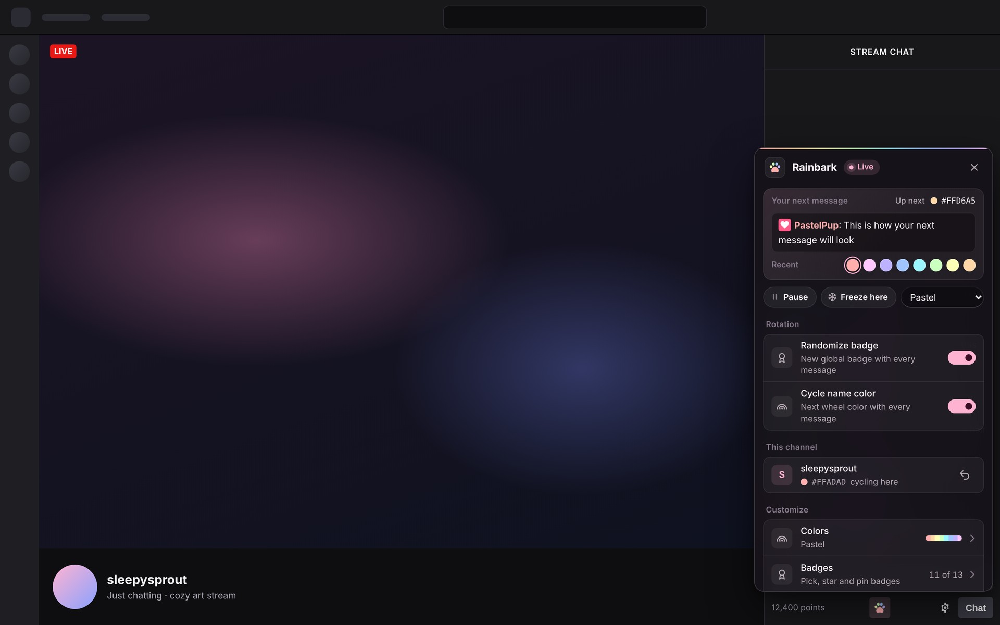
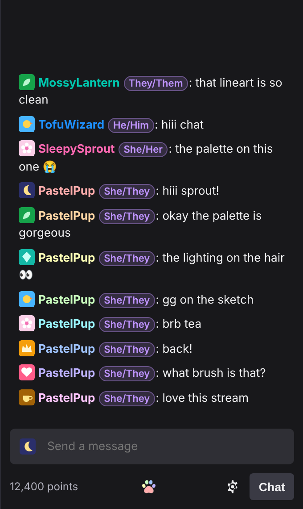
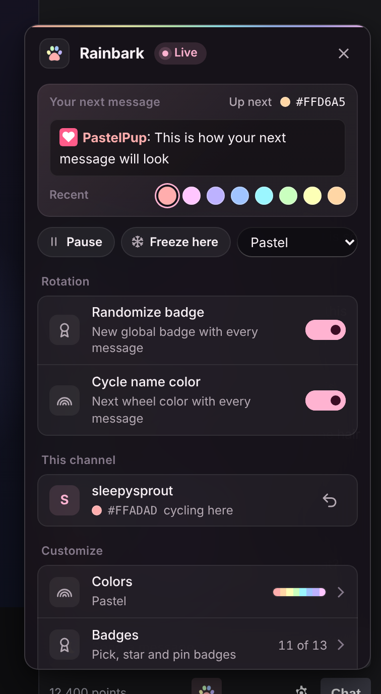
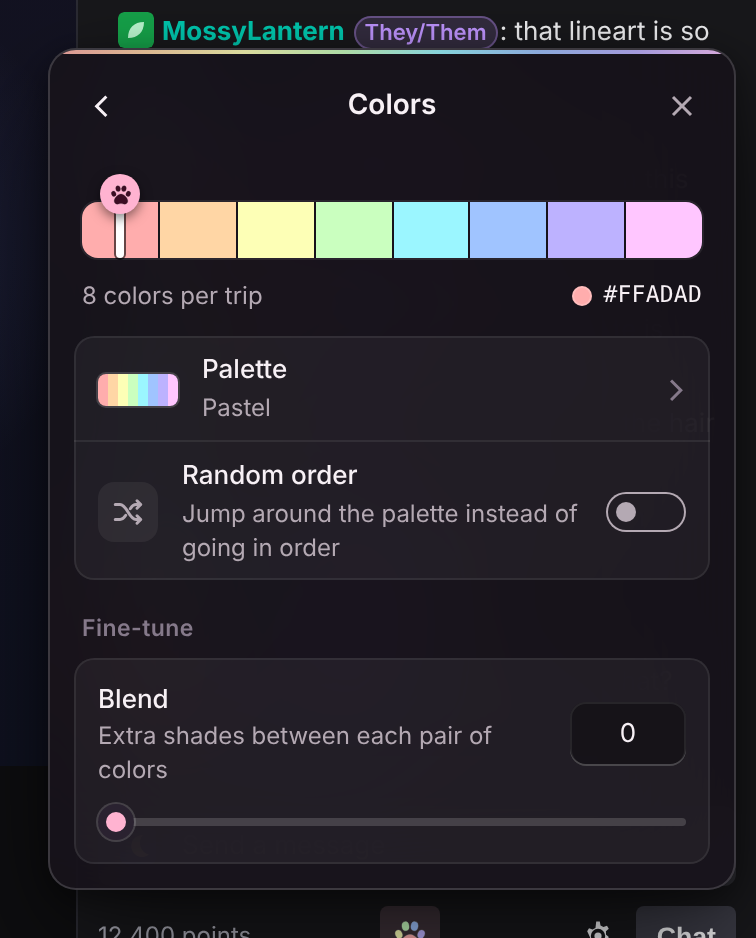
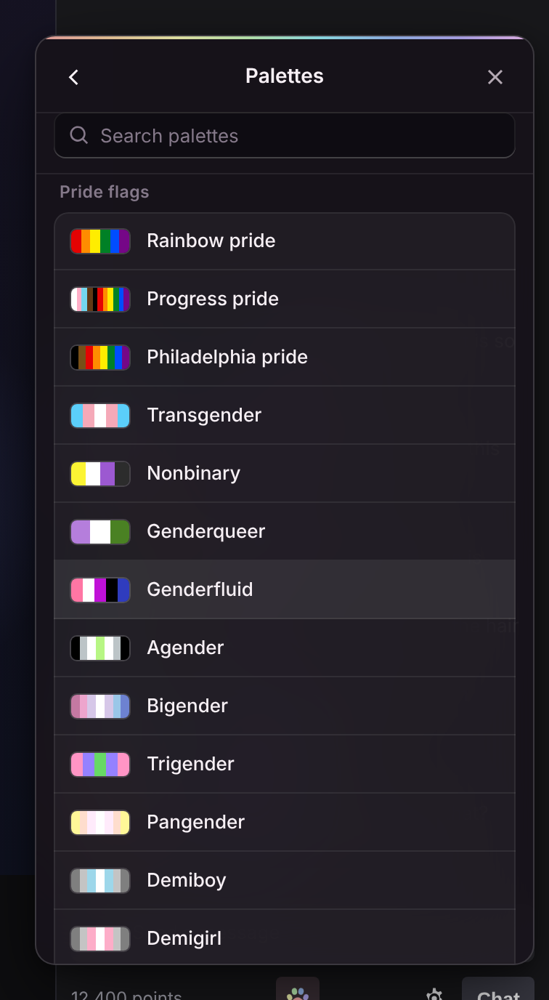
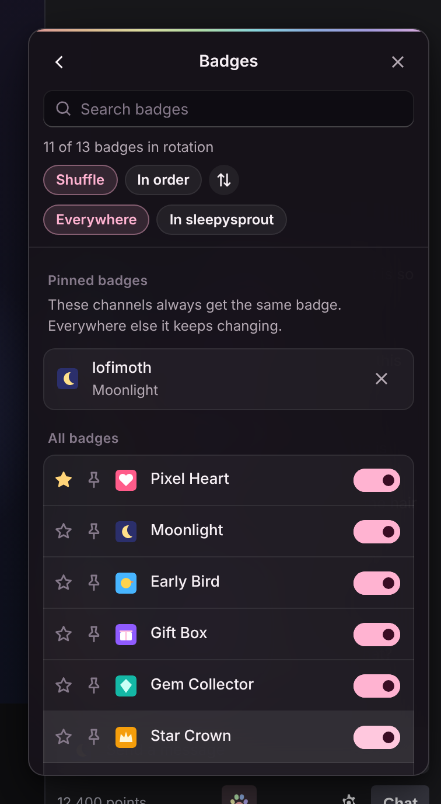
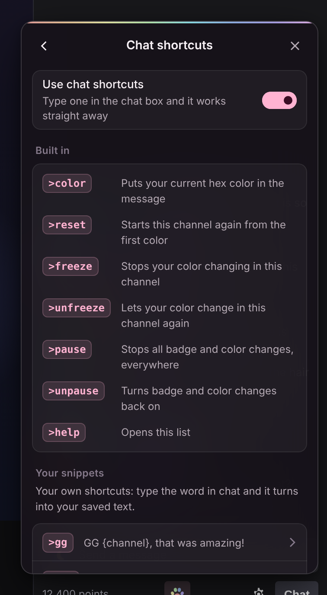
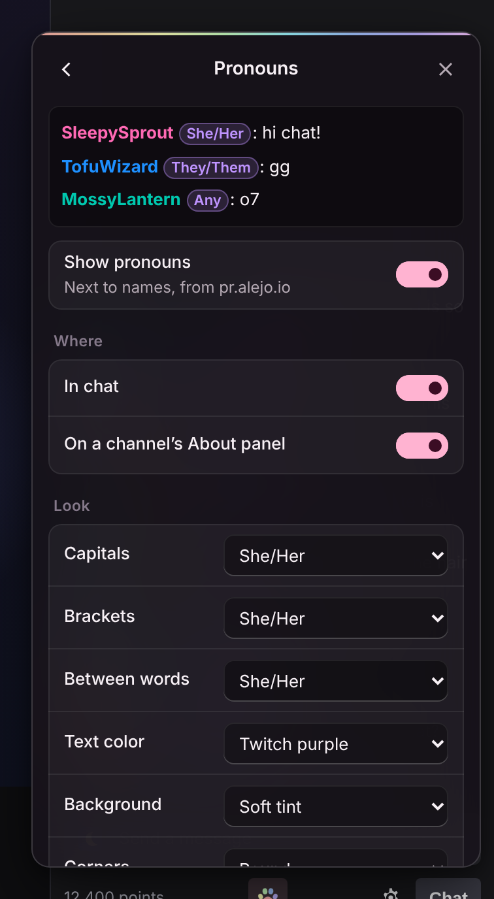
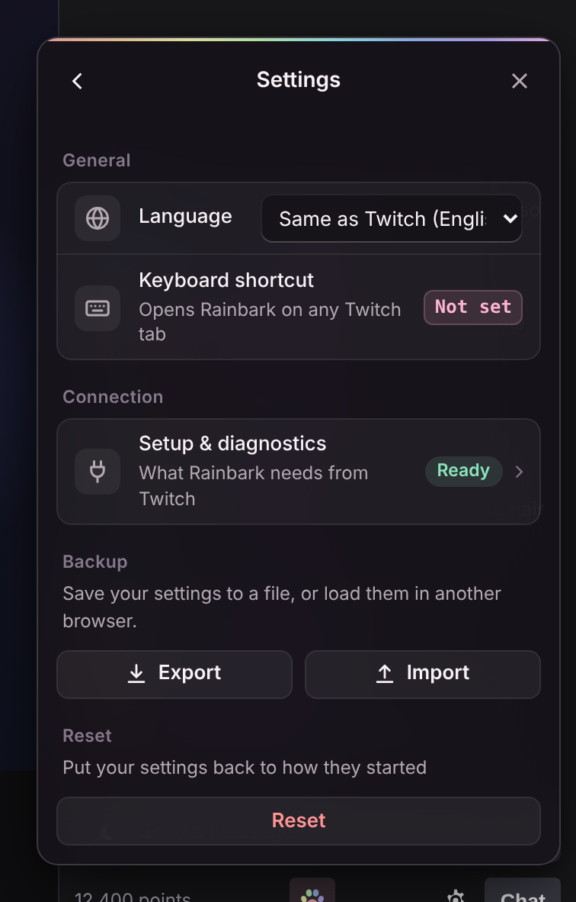
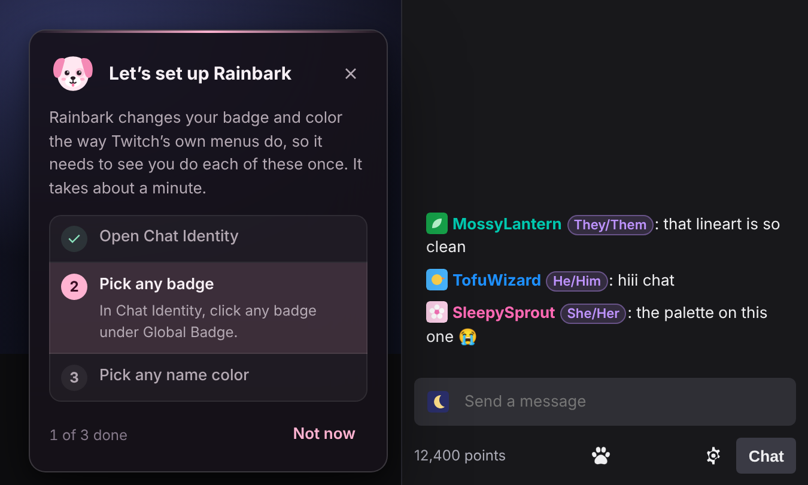

# Rainbark

A browser extension for Twitch chat. Every message you send goes out with a new global badge and a new name color.



**Website:** [rainbark.sinist3r.lol](https://rainbark.sinist3r.lol)

## Install

| Browser | Get it from |
|---|---|
| Firefox | [Firefox Add-ons](https://addons.mozilla.org/en-GB/firefox/addon/rainbark-for-twitch/) |
| Chrome, Edge, Brave, Opera, Vivaldi, Arc | [Chrome Web Store](https://chromewebstore.google.com/detail/jlofkdgmbeleekkegkiflmildahmhgdd) |

Needs Firefox 140+ or a Chromium browser 121+.

Most palettes need Twitch Turbo or Prime, since Twitch only lets those accounts pick any color. The **Twitch free colors** palette works for everyone.

## Gallery

| | | |
|:-:|:-:|:-:|
|  |  |  |
| Chat | Main panel | Colors |
|  |  |  |
| Palettes | Badges | Chat shortcuts |
|  |  |  |
| Pronouns | Settings | Setup guide |

## Features

- **Colors:** rainbow wheel, pastel, sunset and more, 36 pride flags, Twitch free colors, or your own list. Go in order or at random.
- **Badges:** shuffle or set an order. Turn badges off, star favorites, pin one to a channel, or give a channel its own set.
- **Per channel:** each channel remembers its place in the palette. Freeze a channel to keep one color there.
- **How often:** every message, every few messages, or at most once every so many seconds.
- **Preview:** see your next message, the next color and your recent colors. Click a recent color to copy it.
- **Pronouns:** tags from [pr.alejo.io](https://pr.alejo.io) next to names, styled your way.
- **Chat shortcuts:** type `>color` to paste your current hex code. `>help` lists the rest. Add your own snippets with extras like `{channel}`, `{time}` and `{pick:a|b|c}`.
- **Keyboard shortcut:** <kbd>Alt</kbd>+<kbd>Shift</kbd>+<kbd>R</kbd> opens the panel.
- **Creator dashboard:** works in Stream Manager chat too.
- **Languages:** English, Español, Français, Deutsch, Português, Русский and 日本語. Follows Twitch by default.

## Getting started

1. Open any Twitch channel while signed in.
2. Click the paw button below the chat box.
3. Follow the setup card. It asks you to open Chat Identity, pick any badge and pick any color, once.

That's it. Send a message and watch it change.

Rainbark sends the same requests Twitch's own menus do, so it needs to see each of them once. If Twitch updates its site and one stops working, the setup card comes back with just that step. Your settings stay.

### Good to know

- **Change the keyboard shortcut:** `about:addons` → gear → **Manage Extension Shortcuts** (Firefox), or `chrome://extensions/shortcuts` (Chromium).
- **Using Pronoun Tags too?** Rainbark leaves pronouns to it. FrankerFaceZ's Pronouns add-on can't be detected, so turn one of them off.
- **Something broken?** Open **Settings** → **Setup & diagnostics** → **Copy diagnostics** and paste it into an [issue](../../issues). It has no sign-in details or usernames.

## Privacy

No servers, no analytics, no ads. Badge and color changes go straight to Twitch from the Twitch page. With pronouns on, usernames from chat are sent to `api.pronouns.alejo.io` to look up pronouns. Settings stay in your browser. Full details in [PRIVACY.md](PRIVACY.md).

Rainbark isn't made by or affiliated with Twitch or pr.alejo.io.

## Development

### Load from source

**Firefox:** go to `about:debugging#/runtime/this-firefox` → **Load Temporary Add-on** → pick `manifest.json`. It's removed when Firefox restarts.

**Chromium:** go to `chrome://extensions` → turn on **Developer mode** → **Load unpacked** → pick this folder.

### Build the store zip

```sh
./package.sh
```

Writes `dist/rainbark-<version>.zip` with only the files the extension needs. The same zip works for every store.

### Files

| File | What it does |
|---|---|
| `manifest.json` | Extension manifest for both browsers. |
| `page.js` | The panel, badge and color rotation, chat shortcuts and setup card. Runs inside the Twitch page so it can see Twitch's requests. |
| `styles.js` | The panel stylesheet. |
| `languages.js` | All panel text, in English and six translations. |
| `pronoun-look.js` | Pronoun tag styles, shared by the panel preview and the real tags. |
| `pronouns.js` | Finds names in chat and adds pronoun tags. |
| `bridge.js` | Syncs settings to extension storage and between tabs. |
| `background.js` | Welcome page, toolbar button, keyboard shortcut and pronoun lookups (cached for an hour). |
| `welcome.*` | The page that opens after install. |
| `_locales/` | Store description, shortcut name and welcome page text. |

The website lives on the [`gh-pages`](../../tree/gh-pages) branch.

Settings are saved in Twitch's site storage, with a copy in extension storage. The newest copy wins, so changes show up in every tab and on the dashboard. If Twitch's storage is cleared, the copy is restored.

### Making changes

- **Text:** `TEXT_GROUPS` and `LANGUAGES` in `languages.js`. Missing translations fall back to English.
- **Look:** `STYLES` in `styles.js`.
- **Palettes:** `PALETTE_GROUPS` in `page.js`, plus a name in `languages.js`.
- **Version:** `version` in `manifest.json` and `VERSION` in `page.js`. Keep them equal and raise both for each store upload.

Never change the Firefox add-on ID (`rainbark-for-twitch@ame.owo`). Firefox treats a new ID as a new add-on, so existing installs would stop updating.
